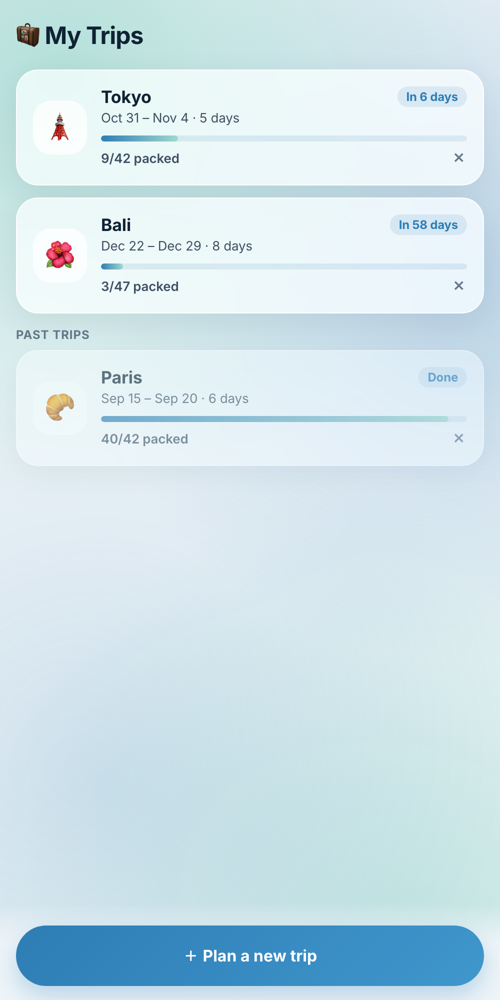
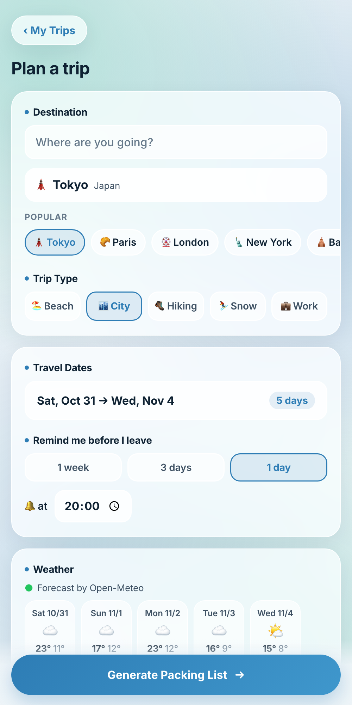
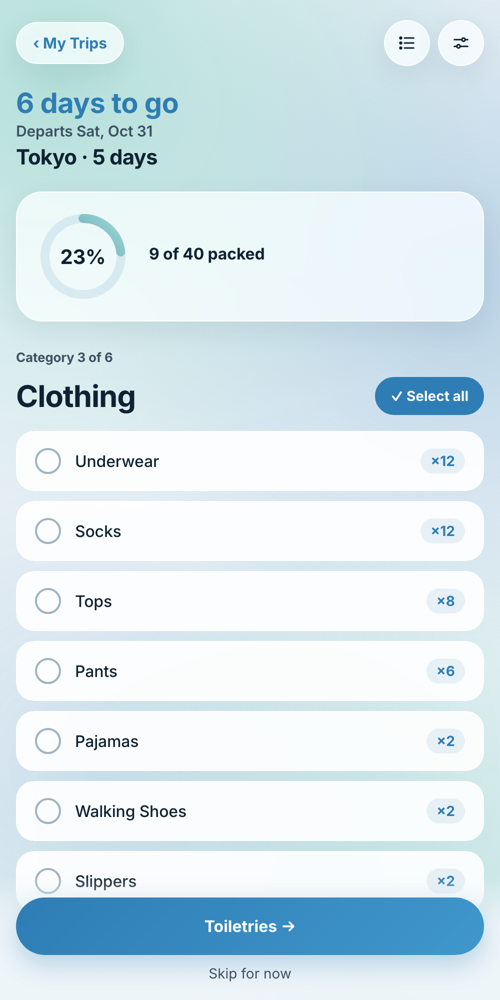
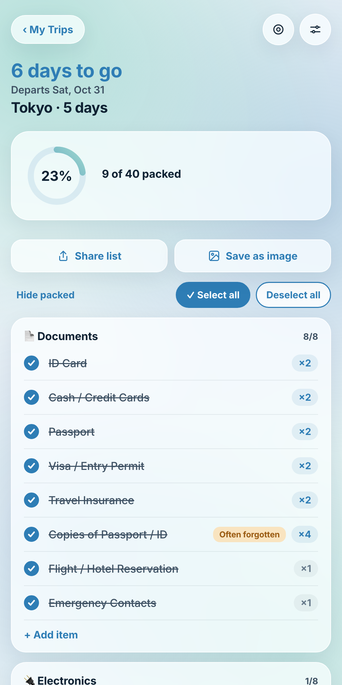

# PackGo — a calm, weather-aware packing list

PackGo builds a packing list for your trip from **who's going, where, when and the weather there**,
then helps you pack it **one category at a time**, so a 40-item list never feels overwhelming.

<p>
  
  
  
  
</p>

## Why I built it

Packing lists are either too generic ("bring clothes") or a wall of 50 checkboxes. I wanted something that
**knows the trip** (a beach week in Bali with a toddler is not a work trip to London in January) and that
**reduces stress** instead of adding to it.

## What it does

- **Smart list in seconds.** Travellers (adults/children, age, gender), destination, dates and trip type
  (beach, city, hiking, snow, work) drive about 70 packing rules. Quantities scale with trip length.
- **Real weather.** A live 16-day forecast for any city worldwide. For trips further ahead, it uses the
  weather on the same dates last year, so there's always something to go on.
- **Focus mode.** Shows one category at a time with a progress ring, plus "Select all" and "Skip for now".
- **Full list.** Hide packed items, change quantities with + / −, share the list as text or save it as an image.
- **Swipe gestures.** Swipe left to delete (with Undo), swipe right to mark an item "often forgotten".
  That mark carries over to every future trip.
- **My Trips.** Several trips side by side, each with its own progress. Your own items copy into the next trip.
- **Reminders.** 1 week / 3 days / 1 day before you leave, at a time you choose.
  The text updates with how much is still left to pack.
- **Private by design.** No account, no tracking, no ads. Everything stays on the phone.

## Design decisions

| Problem | Decision |
|---|---|
| Long checklists cause anxiety | **Focus mode**: one category, one main button, an explicit "Skip for now" so you never get stuck |
| Forecasts only cover 16 days | Fall back to **last year's weather on the same dates** |
| Accidental taps wipe progress | **Undo** on every destructive action (delete, select/deselect all, delete trip) |
| Grey text was hard to read on glass | Darker greys and more opaque cards; cut every grey line that didn't help the user act |
| Two date pickers felt clumsy | **One range calendar**: tap the day you leave, tap the day you return, done |
| Destinations limited to a preset list | **Search any city**, with "abroad" detected from the phone's region |

The visual style ("Glass Sky": `#EEF4F8` · `#0F2233` · `#2E7DB5` · `#9FD8CF`) went through several rounds,
from a sage-green "Calm Focus" concept to frosted glass with soft sky gradients, with the Inter typeface.

## Tech

- Plain **HTML / CSS / JavaScript** (no framework), packaged as an Android app with **Capacitor 8**
- Capacitor plugins: Local Notifications, Share, Filesystem, Haptics, App (back button)
- **Open-Meteo** APIs for geocoding, forecast and historical weather (free, no API key)
- Canvas rendering for the shareable list image
- All data in `localStorage`, versioned with migrations between app versions

```
www/index.html      the whole app (UI, rules engine, weather, storage)
android/            Capacitor Android project
design/             icon source (SVG)
docs/               privacy policy, landing page, screenshots (GitHub Pages)
```

### Run it

```bash
npm install
npx cap sync android
# open android/ in Android Studio and press Run
```

Or open `www/index.html` in a browser for a quick look (notifications and sharing need the Android app).

## How it was built

I designed and directed the product: the features, user flows, visual design, wording and every iteration
based on testing it on my own phone. I wrote the code together with an AI coding assistant (Claude Code).

## Credits

Weather data by [Open-Meteo](https://open-meteo.com/) (CC BY 4.0) · Font: [Inter](https://rsms.me/inter/) (SIL OFL 1.1)

[Privacy policy](https://songxinrong.github.io/packgo/privacy.html)
